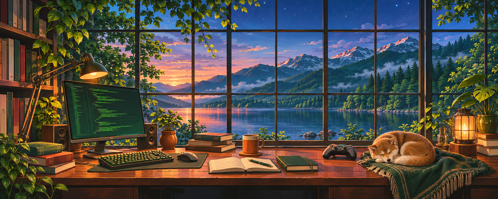

# Hola, soy Noe 👋

Soy desarrolladora full stack, curiosa y autodidacta. Cuando algo me llama la atención, me gusta trastear hasta entender cómo funciona. Y si se me ocurre una idea por el camino, normalmente acabo abriendo el editor para probarla.

Fuera del código, me gustan los videojuegos y soy amante de los animales y la naturaleza 🎮 🐾

## 💻 Desarrollo web

Cuando pienso en una web, me hago dos preguntas: ¿qué tiene de especial el negocio que hay detrás y qué viene a buscar quien entra? Me gusta plasmar la esencia de cada negocio en los detalles, desde cómo cuenta lo que hace hasta lo fácil que resulta encontrar información o ponerse en contacto.

Trabajo con herramientas como **JavaScript, TypeScript, React, Node.js, Python, MySQL y WordPress**.

## 🧪 IA y automatización

Empecé a aprender sobre IA y automatización por curiosidad. Quería ver qué podía aplicar en mi propio día a día y una de las cosas que ya tengo automatizadas es la organización de mi correo. Me gusta probar ideas así y ver si de verdad me hacen más fácil una tarea que repito a menudo.

## 🌿 Sinestesia Digital

[Sinestesia Digital](https://sinestesiadigital.com/) es mi proyecto empresarial. Lo creé porque me importa acercar la tecnología a los negocios y hacer que les resulte fácil usarla. Para mí, el primer paso es escuchar a quienes llevan el negocio y entender qué necesitan de verdad, cómo trabajan y qué les gustaría poder hacer mejor.

**Tecnología al servicio de una atención más humana.** Eso puede ser tan sencillo como una web que resuelva las dudas más habituales o una automatización que quite trabajo repetitivo y deje más tiempo para atender a las personas.

## ✉️ Cuéntame qué quieres mejorar

¿Tienes una web en mente o una tarea que te quita tiempo cada semana? Cuéntame en un par de líneas qué te gustaría resolver.

**[Cuéntame tu caso](mailto:hola@sinestesiadigital.com?subject=Te%20escribo%20desde%20GitHub)** · hola@sinestesiadigital.com
